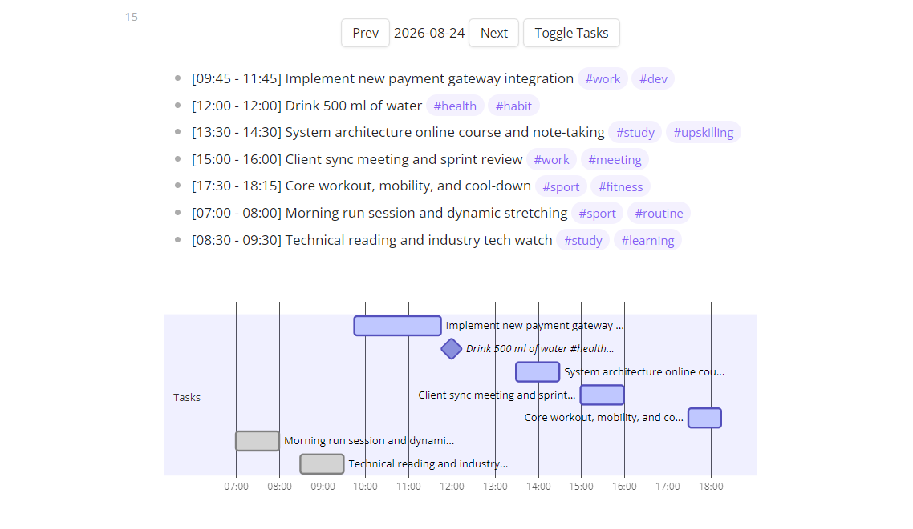

# Obsidian Gantt Timeline

Turn your daily Obsidian tasks into a gorgeous, interactive Gantt chart instantly! ✨

This custom Dataview script takes your standard markdown task lists and transforms them into a clean Mermaid.js timeline—making it easier than ever to visualize your projects, milestones, and daily schedules right inside your vault without needing external tools.



## 📖 Documentation

**[📚 Read the full documentation here!](https://kny00.github.io/Obsidian-Gantt-Tasks/)**
*(Note: Update this link to point to your hosted Vitepress documentation site or GitHub Pages URL).*

## ✨ Key Features

*   **Interactive Timeline:** Navigate through days using built-in "Prev" and "Next" buttons without leaving your note.
*   **Toggleable Task List:** Quickly show or hide a text-based list of the rendered tasks directly beneath the chart.
*   **Smart Date Priority:** Automatically chooses the most relevant date for a task, prioritizing the Completion date, then the Due date, the Scheduled date, or falling back to the file's name.
*   **Highly Customizable:** Filter tasks by specific tags, limit searches to specific folders, or adjust date prefix symbols to match your workflow.
*   **Visual Editing Feedback:** Get immediate visual updates on your Gantt chart timeline whenever you modify the time intervals of your tasks.

## ⚠️ Prerequisites

*   **Dataview Plugin:** Must be installed and enabled. **Enable JavaScript Queries** in the plugin settings is mandatory.
*   **Obsidian Tasks Plugin:** Optional but highly recommended for parsing standard task emojis.

## 🚀 Quick Installation

1. Create a `Scripts/dataview` folder in the root of your Obsidian vault.
2. Place the script file into this folder.
3. Render the Gantt chart in any Markdown note using the following DataviewJS block:

```dataviewjs
dv.view("Scripts/dataview/timeline", {
    includeLocations: "*",
    excludeTasksWithoutInterval: true
});
```

## 📝 Task Syntax

To place a task accurately on the daily timeline, provide a start and end time (24-hour format).

```markdown
// Example using Obsidian Tasks plugin date prefixes
- [ ] Prepare project pitch 🪓 09:00-10:00 📅 2026-08-25
- [x] Client review meeting 🪓 11:00-12:00 📅 2026-08-25 ✅ 2026-08-25

```

## ⚙️ Configuration

You can customize the script's behavior using inputs in your `dv.view()` block or via Obsidian frontmatter properties. See the Configuration section in the documentation for advanced filtering and display options.
